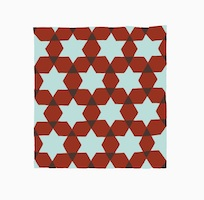

# geoislam
Islamic geometry for pen plotters
# Geoislam

Instead of extending recurrink, geomislam will be clean break. New code to plot islamic geometry. The scope is:

1. generate circles and polygons
2. decompose into smaller shapes wherever they intersect
3. meander each shape
4. transform shapes into SVG

Once imported into inkscape
1. discard redundant shapes
2. group and colorise
3. tesselate 

## Inkscape tricks

### Group and colorise
- Right click selected object
- Choose `Select Same` > `Stroke Colour`
- Move selected objects to the Layer for that colour

### Crop
- Tesselated isometric grids overhang
- Overlay a rectangle to divide what is to be kept and discarded
- Select both the object to be cropped and the rectangle
- Choose `Path` > `Intersection`  
Only vectors inside the rectangle remain

### Stroke Width
Stroke widths are set a .5 or 1mm but Inkscape renders them
without any gaps, making it impossible to see the meander lines.

To overcome this manually set to a lower value, e.g. 1mm becomes .7mm.
You can do this in Python, but Inkscape will ignore you :sob:


## Runtime
Neither sesenta or this project have successful shapely installs.
Instead, start the code/recurrink virtual env and cd ../geoislam

## TODO
1. add geoislam
1. use passw.py to create project folders on pcloud
1. refactor six.py 1) draw() returns single 2) remove XY fromCircle()

1. offset stars in fromCircle t.six.Test.test_a

1. YAML config reader ./geomislam CONF --init
1. validate inputs with Pydantic
1. merge six.main and eight.main and call generic methods eg. shape.drawPetals

## HOWTO

### Meander with different pen widths
Meander has a default two axis method for drawing petals. Six and Eight shapes also have three and four axis methods. Pen widths can be either fineliner (0.5mm) or standard (1mm).Only the two axis method supports fineliners. 

  
__Six Star Petals__

  
__Eight Star Octagon__


All tests run with 60mm Height and Width.

The scale hack in SvgModel has been disabled.

### Generate inner or outer shape
Both stars are constructed from hex/oct shapes. Use the pos arg to control which position is generated. For example
```
star8.octagonPoints(polygn, pos='outer')
```


### Build SVG files with make
Each SVG file is a target. There is one target per option, e.g. `sixpf2.svg`. The are no dependencies, all the SVGs are re-built. Filter as follows:
```
make sixpf2   # petals filled using 2 axis meander
make six      # all SVGs derived from six point star
make all      # everything  
```
The make commands call the PY files with the options to make the target. Global vars are height width (hw) and stroke width (swd). These need to be set in the Makefile.

### Creating a composite block
To avoid repetitive work in Inkscape, a custom script could compose a repeatable block using the base shapes defined in the Python classes.

1. Add XY inputs to .fromCircle() so xy can be offset
2. Write a new class that returns a collection of construction lines 
3. With shapely.intersect and interpolate create star instances with offsets
4. Crop shapes that overhang the cell boundary
5. Use SvgModel to generate SVGs from shapes



_custom script should create a block like above_


## Shapes


