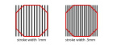
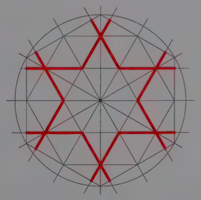
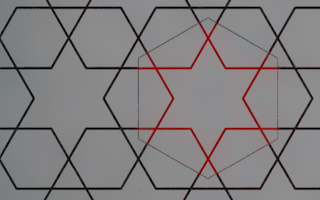
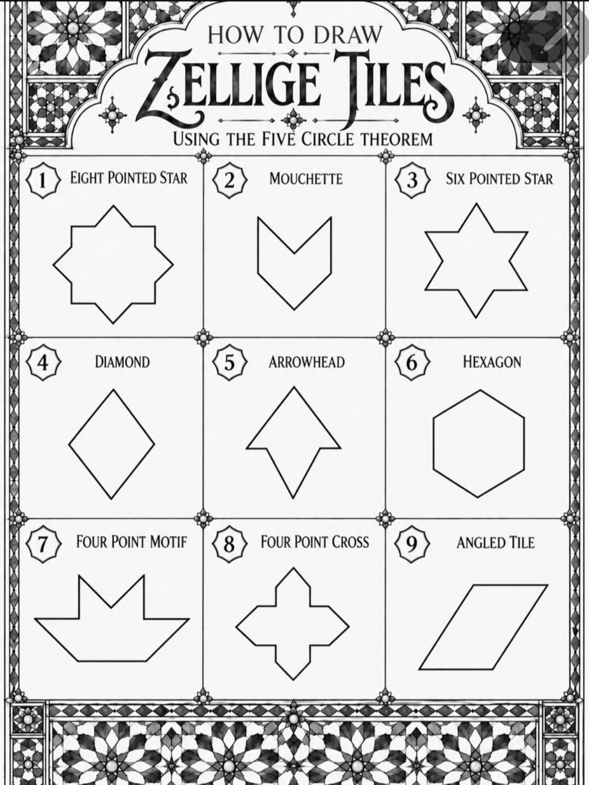

# geoislam
Islamic geometry for pen plotters

## Motivation
Recurrink (see other repository) generates SVG for plotters based on config.
Instead of extending recurrink, geoislam is a clean break. New code to plot islamic geometry. The main difference is that designs are scripted rather than configured. The scope is:

1. generate circles and polygons
2. decompose into smaller shapes wherever they intersect
3. meander each shape
4. compose shapes into an SVG block

Once imported into Inkscape
1. add color and tesselate 

## Inkscape tricks

### Group and colorise
> Plotter needs one layer per colour  

- Right click selected object
- Choose `Select Same` > `Stroke Colour`
- Move selected objects to the Layer for that colour

### Crop
> Tesselated isometric grids overhang border

- Overlay a rectangle to divide what is to be kept and discarded
- Select both the object to be cropped and the rectangle
- Choose `Path` > `Intersection`  
Only vectors inside the rectangle remain

### Stroke Width
> Stroke widths are set a .5 or 1mm but Inkscape renders them
without any gaps, making it impossible to see the meander lines.

`SixStar.__init__` will set gap at .1mm less than stroke width.
 but sometimes Inkscape will ignore us :sob:.
To overcome this manually set stroke width to an even lower value, e.g. 1mm becomes .7mm.

## Runtime
Neither sesenta or this project have successful shapely installs.
Instead, start the `code/recurrink virtual env` and `cd ../geoislam`

## TODO
1. custom script based on eight 

## HOWTO

### Meander with different pen widths
Meander has a default two axis method for drawing petals. Six and Eight shapes also have three and four axis methods. Pen widths can be either fineliner (0.5mm) or standard (1mm).Only the two axis method supports fineliners. 

  
__Six Star Petals__

  
__Eight Star Octagon__


All tests run with 60mm Height and Width.

The scale hack in SvgModel has been disabled.

### Generate inner or outer shape
Both stars are constructed from hex/oct shapes. Use the pos arg to control which position is generated. For example
```
star8.octagonPoints(polygn, pos='outer')
```


### Build SVG files with make
Each SVG file is a target. There is one target per option, e.g. `sixpf2.svg`. The are no dependencies, all the SVGs are re-built. Filter as follows:
```
make sixpf2   # petals filled using 2 axis meander
make six      # all SVGs derived from six point star
make all      # everything  
```
The make commands call the PY files with the options to make the target. Global vars are height width (hw) and stroke width (swd). These need to be set in the Makefile.

### Create a composite block
To avoid repetitive work in Inkscape, write a custom script to compose a repeatable block. 




_custom script should create a block like above_

The script uses the shapes defined in the Python classes.
Shapes can be created either by the Makefile recipes, or with custom code.
Inputs to `.fromCircle()` include a centre point so shapes can be offset
With shapely.intersect shapes that overhang the cell boundary can be cropped.

### Data or algorithm ?
The custom script can either use a database to transform geometries, or an algorithm.
The algorithm uses a template to generate eight stars. The database contains entries for each star.

To determine which approach works best.
1. fork the code with the database on main 
2. develop interfaces so that the same unit tests can be applied to both versions

## Shapes
Some nice things to do .. later :grin:


